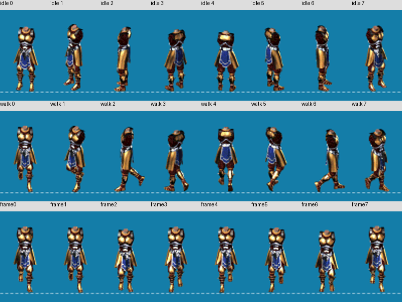
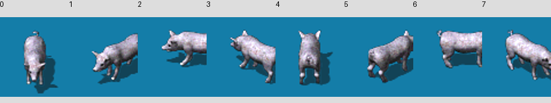
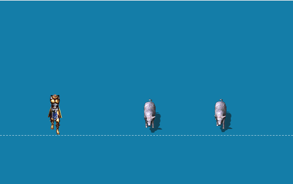

# v0.10.11 SA12 — real eight-direction animation MVP

**IMPLEMENTED / FINITE_REAL_ASSET_BROWSER_EVIDENCE / DEVELOPER_ACCEPTANCE_PENDING.**
This is a runnable manual MVP, not a release or blanket visual acceptance claim.

## Delta preflight

Previous checkpoint/base: `2c11bbc60cf6fa36a39813e7f5e40188279debfd` (SA11).
Main baseline: `78dc4a9d14288df33ca46b3af4d23d09ceef9b82`. Existing branch
`feat/sprite-directional-animation-v0.10`, Draft [PR10](https://github.com/TjnhPro/rpg-platform/pull/10).
Containing commit and exact-head CI are recorded in the PR ledger after push.

Primary owner: **runtime-render**, canonical sprite presentation/MVP. Editor and
Client remain existing public-root consumers, with SA10/SA11 manual hosts and
observations; this checkpoint adds no consumer production adapter. Harness owns
evidence only. Route hints identify Render. No gameplay rules or L1/L2 calls.
Read root/Render guidance, architecture/foundation, Harness ownership/contracts/
workflow/verification/failures, prior report, current animation playback/binding/
alignment and emitted declarations. Phase4/6/7/8/9 seams exist at this baseline.

Scope: optional Render manual HTML/MTS/server/config/manifest/guide, screenshots
and this report. **Zero production src, public signature/export, dependency,
schema or ownership delta.** No duplicate renderer, decoder, cache, clock, Scene
manager, foundation edit or sixth project. No tests/assertions/runners introduced.

## Composition and source identity

The [reproducible guide](../../runtime-render/manual/sprite-animation-mvp.md)
provides build/server commands and exact input steps. Manifest has48 original
files (24 PNG/TPSheet pairs), explicit byte lengths/SHA256, page identities and
frame arrays. Original sources are local sibling asset-sources, not committed
replacement art. Player BODY idle/walk have eight real different facing sequences,
8/7/8/7/8/7/8/7 frames; Monster NormalWalk has eight sequences of four frames.
Runtime readiness resolves every authored key through the canonical atlas API.

Render public root supplies prepareVisualResource, source load, Unity parser,
resolveAtlasFrame/geometry, cache/leases, eight-way clip/orientation selection,
playback/command/advance/readback, visual binding, actual graphics session,
Scene/instance transforms, resize and configured camera/Scene binding. The host
only grants exact local bytes, verifies SHA256 and sends explicit input/delta.
No frame cropping/upload-per-frame. Original source pivot stays metadata.

A/B share the same Monster descriptor/atlas/cache and session, separate playback
and leases. C has another graphics session and context-local GPU entries in the
same canonical cache. Main P(90,220), A(235,160), B(350,160); C(240,160).
Both viewports are480x300, DPR1, camera center(240,150), scale1, zoom1.
Initial cache CPU24/GPU32/leases44; sourceJobs24/uploadCalls32/cpuHits8/gpuHits8.

## Observed browser evidence — Chrome, 2026-10-24

All below are actual manual control operations/readback, not build-inferred PASS.
Images are finite screenshots, with enlarged contact crops for inspection.
Local raw readbacks live in ignored `.artifacts/sa12/observed-final.json` and
`directions.txt`; final/sequence originals are in local evidence artifacts.

| INPUT | EXPECTED | OBSERVED | NOT_OBSERVED / precision |
| --- | --- | --- | --- |
| P idle/walk, each slot0..7, Stop/Play/125ms | Frame1 in declared resource and placement(90,220) | Playback and bound keys BODY_0002,0018,0032,0048,0062,0078,0092,0108; distinct real facing pixels; no failure | Source compass/FPS unknown; slots/rate are authored |
| A walk, each slot0..7, Stop/Play/125ms | Four-frame sequence frame1 | Bound and playback keys0002,0010,0018,0026,0034,0042,0050,0058; distinct creature facing pixels | Not every frame of every direction photographed |
| P idle to walk | Resource changes, ground placement preserved | player-idle to player-walk; same placement/attachment(90,220), real pose changes | Full equipment composition absent |
| P walk slot0,0..875ms in125ms increments | BODY_0000,0002,0004,0006,0008,0010,0012,0014 | All eight selected/bound keys agree; canvas legs change; sole stays at Y220 inspection line | Authored x12 reference, not original anatomical center |
| Play same clip at875 | No restart |875/BODY_0014 remains | No wall-clock animation claim; explicit stepping |
| Facing0 to1 while playing at875 | Retain logical875; seven-frame target wraps to0 |875/BODY_0016 | This is target-local modulo, not fractional-progress transfer |
| Pause, Step250, Resume, Step125 |875 paused then1000 playing |875/BODY_0016 then1000/BODY_0018 | Continuous scheduling covered separately by SA11 finite evidence |
| Stop then Play, Step1000000 in slot1 | Stop0; remainder750/frame6 | stopped0/BODY_0016 then playing1000000/BODY_0028 | Binary64 public numeric contract; no frame event queue |
| Step -1 | Reject, retain1000000 and last bound frame | TypeError; playback/visual remain BODY_0028 | Other invalid numeric classes not repeated here |
| Missing authored origin / absent frame key | Explicit rejection, preserve good state | FRAME_ORIGIN_UNAVAILABLE / FRAME_NOT_FOUND; BODY_0028 remains | Missing-key button calls resolver, not binding |
| walk-once slot0,1000ms | Completed final frame7 | completed1000/BODY_0014, bound same | Native continuous once pixels not separately captured |
| A125, B250 with shared Monster atlas | Independent progress | A0002/B0004, both visible | C remains stopped0 independently |
| Release A, B+125 | A disposed; B375/frame3 survives | A absent, B0006 visible; no failure | Native driver memory not measured |
| Close main, C Play/+125 | Main disposed; independent C usable | P/A/B disposed, C playing125/0002 visible | Native context loss not injected |
| Close all | All scopes released | All playback disposed, cache disposed, CPU/GPU/leases/revisionEntries0, cleanupFailed false | sourceJobs24/uploadCalls32 are cumulative counters; driver reclamation unknown |

Player anchor tables were authored after enlarged source BODY sole inspection.
Each supported Y explicitly follows that frame's lowest sole line; x12 is an
authored reference. The observed supported frames and sampled eight directions
keep Y220. No original untrimmed layout/center/trim=0 inference: original origin
is UNKNOWN. Monster top-left0,0 is an inspection origin, not anatomical ground.
Frame-source rotation none/trim null/sourceSize null remain Phase7's limitations.

## Gates and diff audit

| Command | Actual result |
| --- | --- |
| `npx tsc -p runtime-render/manual/sprite-animation-mvp.tsconfig.json` | exit0; strict isolated manual consumer compiles |
| `node harness/cli.mjs check` | exit0; ARCH_CHECK_PASS174 source files |
| `node harness/cli.mjs scope --projects runtime-render --allow-infra` | exit0; Render/Harness scope only |
| `node harness/cli.mjs verify --projects runtime-render --with-consumers` | exit0; genuine Render, Editor, Client builds PASS |
| `npm run build -- --force` | exit0; genuine TypeScript five-project workspace build |

No failed/unconfigured project build. Temporary CLI multiline observation capture
initially had a syntax error; flattening CLI input corrected it before collecting
the recorded results. Observation command output was explicitly returned before
readback capture. No automated suite or assertions were created/run. Production
src and package/lock diffs against SA11 are empty, so no exported API delta.
Preexisting untracked `.mcp.json`, local browser outputs and observation helpers
are excluded from commit. Screenshots are evidence, not snapshot tests.

## Limits and next checkpoint

No blanket MVP_PASS/Developer acceptance claim. Finite supported real-asset MVP
is observable and reproducible. Unknown: original source compass/FPS/untrimmed
anatomical pivot; complete Player composition; every pixel of every frame across
all directions; hidden/minimized/pagehide/BFCache; native GPU loss/restoration,
cleanup failure injection and native memory reclamation. Terminal guards remain
existing Render/host contracts, not new recovery logic. Editor/Client reuse of
Render is source/build-confirmed with their prior finite browser observations;
this checkpoint does not claim a new full per-consumer pixel matrix.

Ready for the supplied v0.10.12 full-phase audit task; no next-version work,
merge/tag/publish/release is implied. Developer alone accepts the phase.
