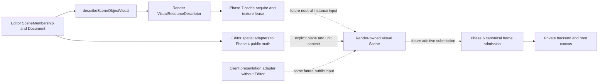

# Scene Rendering architecture — v0.8.0 / SR01

Status: **API_DESIGN_ONLY**. This checkpoint implements no scene manager or GPU
allocation. The decisions below constrain subsequent supplied tasks; operation
names in prose are capabilities, not promised public signatures.

## Audited integration baseline

Branch `feat/scene-rendering-v0.8` starts at merged `main`
`ffb347140fbe6bf432bb8fe33c7057bed9a93941` (PR #7). Phase 6 merged at
`33c9da5ac79cfce27043927fe5d7e08e3bd6d02c` (PR #6); Phase 7 production ends at
`8e43b40df3375559e703d416109b48e6360ccf48`, followed by closure
`63df7e743f004100085a0fc131ab7408e9dc91d5`. The task's older main/OPEN-PR6
description is superseded by these actual merged dependencies. Merge establishes
the Git integration baseline, not functional or visual acceptance of those phases.

Only the package roots are public. Current emitted root names are Render 126,
Editor 134, Client 0; the complete Phase 7 signatures remain in the
[public inventory](public-api-delta-v0.7.14.md). Source/declarations, not that count,
determine whether a capability exists. No public root, signature, manifest, lockfile
or production source changes in v0.8.0. No new compiled consumer is necessary for
zero API delta; existing genuine project/manual consumer builds remain required.

## Four scenes and five identity domains

| Domain | Owner and lifetime | Must not become |
| --- | --- | --- |
| Authored Scene / `SceneMembership` | Editor immutable definitions, references, optional placement and opaque relationships; can exist without graphics | A live renderer store or runtime resource archive |
| Runtime Visual Scene | Render session-local presentation state, future opaque scene/instance capabilities | Editor Document, gameplay world or global SceneRegistry |
| Private `THREE.Scene` | Existing `three-frame.ts` backend object; no consumer access | A public scene handle or serialized authoring schema |
| Gameplay world | Runtime Engine game-specific state/lifecycle/policy | A consequence of frame submission or visibility |

Asset ID identifies content; authored Object ID identifies a scene-local definition;
live Visual Instance identity identifies an independent presentation allocation;
Render Session identity identifies graphics lifetime; gameplay Entity ID identifies
game rules. Equal authored IDs in two previews do not identify the same instance.
The host may retain optional correlation between these domains, never serialize
live handles or use an authored string as the capability to mutate Render state.

## Source-backed flow and missing links

Solid edges exist; dotted edges are design obligations, not working APIs.

- `editor/src/scene-membership.ts` owns authored definitions, list order,
  `layerKey`, attachment and optional placement. Declaration order is not draw
  order; attachment is not parent/following/transform inheritance.
- `editor/src/scene-visual.ts:describeSceneObjectVisual` returns caller-retained
  correlation, nullable placement and described/unsupported asset result. It
  neither forwards layers/attachments nor creates instances. Only its descriptor
  currently crosses to Render. `asset-visual.ts` maps image kind and source roles;
  the Asset resolver still rejects authored subresources. Future frame selection
  must explicitly use Render frame APIs; do not silently interpret that rejection
  as a successfully selected atlas frame.
- `scene-spatial-point.ts` and `scene-visual-alignment.ts` adapt explicit matching
  authored space/unit/axes into Render-owned data/math. `planar-transform.ts`,
  `planar-affine.ts`, `visual-alignment.ts`, plane projection and viewport mapping
  remain canonical. Facing metadata does not rotate geometry/select animation;
  anchor values are local units, not normalized image fractions. Pixel-to-plane
  scale and coherent projection are explicit host inputs, never guessed from Y/DPR.
- `document-scene-edit.ts:replaceSceneDocumentObject` preserves supported unknown
  metadata through canonical owner validation. Presentation allocation, redraw,
  clear and disposal never edit content, revisions, dirty state or saved baselines.
- `editor/src/viewport-host.ts` owns on-demand scheduling/layout/unmount; Client's
  `src/manual-frame-continuous.ts` owns its independent continuous host policy.
  Phase 7 manual resource adapters also use Render root only. They are optional
  browser entries, not public scene managers; Client never needs an Editor import.

## Compatibility and dependency matrix

Signatures below are current root API excerpts; private helpers are not consumer
entrypoints. All paths in this table are relative to `runtime-render/src/`.

| Actual capability | Existing contract / implementation | Phase 8 use or missing seam |
| --- | --- | --- |
| Binding only | `createRenderSessionLifecycle(host): RenderSessionLifecycle`, `index.ts` | Remains reference-only; bound never means GPU/scene-ready |
| Graphics acquisition | `createRenderFrameSession(host): Promise<RenderFrameSession>`; `beginRenderFrameSession(host): RenderFrameAcquisition`, `frame-session.ts` | Reuse canonical session, target reservation and terminal observations; structural lookalikes are not accepted native capabilities |
| Frame | `RenderFrameSession.renderFrame(): RenderFrameReceipt`, same file | Synchronous, submitted-only receipt with historical viewport; currently renders empty private scene. No visual-scene argument/attachment exists. Preserve legacy empty-frame behavior; future scene submission should be an explicit additive operation through the same admission/receipt/cleanup path |
| Viewport | `getRenderViewportSnapshot`, `resizeRenderViewport`, suspend/resume, `viewport-size.ts` | One full-buffer viewport; host metrics/ratio, Render sizing. No scene-local resize, region or independent canvas |
| Demand | `invalidateRenderFrame`, `getRenderFrameInvalidationSnapshot` | Future accepted visual mutations invalidate existing demand; hosts schedule. No Render RAF/clock; invalidation during submission must survive captured-token acknowledgement |
| Metadata | `prepareVisualResource(descriptor): VisualResourcePreparation`, `visual-resource.ts` | Detached metadata / `NOT_PERFORMED`, never resource readiness |
| Loaded rights | `createVisualResourceCache(provider, limits): VisualResourceCache`; `cache.acquire(session, descriptor, index, expectedRevision, decodeLimits, options): VisualResourceLease`, `visual-resource-cache.ts` | Real source/decode/upload implementation with independent consumer rights, bounded entries and exact revisions. No second cache/loader |
| Texture | `uploadPngTexture`; `getRenderTextureSnapshot(session, texture)`; `RenderTexture.release`, `render-texture.ts`, `three-frame.ts` | Canonical same-session live right required. Native WebGLTexture is private, not a public `THREE.Texture` |
| Atlas | `parseUnityAtlasMetadata`, `getAtlasMetadataRevision`, `resolveAtlasFrame`, `resolveAtlasFrameGeometry`, `createAtlasTextureView` | Actual strict Unity40300 rectangular profile and canonical geometry. View borrows a texture: **no independent frame lease or retain API**; retain a dedicated image lease for its lifetime |
| Resource demonstration | `renderVisualResourceDemo(session, texture, geometry?): RenderFrameReceipt` | Same session admission; one central-80% stretched native quad, no retained instances/scene/ordering/placement. Do not use it as a scene implementation |
| Scene/instances | No public create/update/remove/clear/dispose capability | Subsequent supplied checkpoints must demonstrate the minimum neutral consumer surface; no speculative DTO/registry now |

Dependency disposition: Phase 6/7 actual public capabilities and release paths
exist at the pinned merged baseline. **No missing upstream dependency blocks this
architecture checkpoint.** Source availability and compilation do not establish
native-browser success. Existing `VisualResourceLease.result` is a historical
observation; re-read current snapshots before using a capability.

### Native texture integration is a real future seam

The backend uploads via checked native WebGL calls and stores bindings privately
(`three-frame.ts:uploadTexture`, `render-texture.ts:textureBacking`); the demo
resolves that backing inside the same backend with public Three `resetState`
around native work. A lease cannot be cast into a Three material map. No supported
public wrapper importing that existing allocation into a Three material is proven
by this audit. Future rendering must integrate with this canonical backend and
Phase 7 allocation owner; a Three material strategy must prove supported interop
without a second upload/cache, private Three internals or changed lease semantics.
If a supplied implementation task requires such a strategy without a supported
path, stop with exact evidence/options. This checkpoint selects neither a second
renderer nor a material/texture interop implementation.

## Lifetime and operation decisions (future implementation)

MVP supports one active Visual Scene per acquired graphics session; independent
sessions have independent live scenes/instances and GPU allocations. There is no
global current scene, automatic cross-session transfer or revived handle after
context loss. A second active attachment must reject without replacing the first.
Whether detached inactive scenes are needed remains uncommitted until a consumer.

| Intended operation | Owner / required semantics |
| --- | --- |
| Create scene / instance | Render issues new opaque identity scoped to canonical graphics session. Validate portable definition/context and resource ownership before adoption. Definition capture alone allocates no GPU object. No authored-ID upsert |
| Update | Preserve live identity; validate complete candidate and acquire independent candidate rights before swapping. Failed admission retains old presentation. Source/decode/atlas failures release candidate only; terminal GPU failure may invalidate the entire failing session |
| Hide | Render visibility state; retains instance and its dedicated lease. Hidden is neither removed nor disposed |
| Remove | Detach selected instance, make its handle terminal, release only its rights and native instance-owned geometry/material objects. No authored removal, cascaded attachments or cache-wide disposal |
| Clear | Remove all owned instances/rights; keep scene/session usable; never dispose borrowed cache, session or canvas |
| Dispose scene | Terminal, idempotent, detach active association and drain all instance cleanup attempts. Preserve failure observations; no borrowed host/session/cache destruction |
| Dispose/fail graphics | Canonical session ends admission, invalidates dependent scene/instance work and leases before backend teardown. Late source/decode completion cannot adopt an old instance; use per-operation generation/intent guards. New graphics session requires fresh live handles |

Resource ownership plan: one dedicated Phase 7 acquisition right per independent
instance use, shared allocation only through that cache. No retain-by-copy of
`RenderTexture`/view references. Future API must choose explicit transfer admission
or accept acquisition inputs and obtain its own right; that signature/handshake is
deferred. Callers cannot keep releasing a transferred capability. Native materials,
geometry and object records belong to Render; deleting them does not authorize
deleting shared image allocations. Unmount closes host intent/callbacks first,
drains scene rights, disposes any host-owned cache then graphics, and releases late
results. Session-terminal cleanup remains authoritative if it occurs first.

Failure domains remain distinct: invalid neutral input/foreign or stale capability;
source/decode/atlas rejection; cache admission; graphics terminal/cleanup failure;
host scheduling/layout. Preserve recognized diagnostics and unknown exceptions.
Never turn partial cleanup into clean success or silently revive quarantined
targets. Future scene diagnostics need consumer evidence before new unions/codes.
Rollback for v0.8.0 is documentation-only; future candidate rollback must release
new rights without undoing an independently accepted authored Document edit.

## MVP envelope and ordering

Planar 2.5D, static whole PNGs or supported atlas frames, one active scene per
graphics session. Render owns comparison: explicit numeric layer priority first,
then a declared within-layer ordering policy with direction/coordinate context,
then a stable per-scene creation ordinal tie. Updates retain the ordinal; remove
and recreate receives a new one. No authored string lexical order, inferred screen
Y/world depth, entity role or private Three ID determines ties. Exact policy fields
and material/depth behavior await the sorting consumer checkpoint.

The eventual planar alpha profile must explicitly coordinate blend/depth state
and submission order; sorting alone cannot solve arbitrary intersecting transparent
3D geometry. No general transparency correctness is claimed. Unsupported: nested
scenes, parenting/following, prefabs, ECS/component registry, arbitrary meshes,
perspective/isometric inference, camera controllers, animation/VFX playback, picking,
gameplay collision/AI/spawn, network authority or server GPU dependency.

## Evidence vocabulary and references

| Stage | Evidence required; never inferred from prior stage |
| --- | --- |
| Definition captured | Portable validated presentation input only |
| Instance created | Actual Render-owned handle/state accepted (not implemented here) |
| Resource GPU-ready | Current same-session texture/lease usable; upload accepted without detected GL error, not GPU completion |
| Frame submitted | Actual canonical synchronous submitted receipt; not display acknowledgement |
| Visually observed | Independent manual browser observation with exact revision/assets/session/configuration |

At v0.8.0 no new runtime experiment/browser observation is performed:
**FEATURE_NOT_VERIFIED / VISUAL_NOT_VERIFIED**. The Phase 7
[closure evidence](visual-loading-v0.7.14.md) records parser/geometry observations
for real Unity40300 sheets, not GPU display. **TPSHEET_METADATA_OBSERVED /
TPSHEET_VISUAL_NOT_VERIFIED**; other exporter profiles remain unsupported. Its
original CC0 2x2 PNG is redistributable; external Wound/Attack assets have no
established redistribution rights and are neither copied nor changed here.

Installed/locked `three@0.186.1`, `@types/three@0.186.0` remain unchanged. Official
r186 docs queried alongside installed source; current online docs are orientation,
not permission to use newer APIs:

- [Three Object3D](https://threejs.org/docs/pages/Object3D.html): renderOrder does
  not merge opaque and transparent lists; backend identity stays private.
- [Three WebGLRenderer](https://threejs.org/docs/pages/WebGLRenderer.html): reuse
  render/resize/dispose and public state reset; no animation loop added here.
- [Godot CanvasItem](https://docs.godotengine.org/en/stable/classes/class_canvasitem.html):
  explicit Y sorting/Z-index informs policy separation, not a copied scene tree.
- [Unity 2D sorting](https://docs.unity3d.com/Manual/2d-renderer-sorting.html): layer
  priority and within-layer order inform the distinction, not an imported schema.

Rejected alternatives: Editor/Client-owned renderer; authored-ID live handles;
implicit layer/depth conversion; global scene/cache; per-instance loader; binding
session reinterpreted as graphics; forced new DTOs without consumer evidence.
No L1/L2 APIs are newly consumed: Engine retains frozen Core2.0.0
`04b7239f998c3c688a0dfa3202f11811a9acd775` and Gameplay0.15.2
`acea332aa80f67552192a72b30f81c0bbbfc56bd`. Exactly five projects remain.

Next checkpoint readiness is architectural, contingent on genuine build/static
gates in the [checkpoint report](../../harness/checkpoints/scene-rendering-v0.8.0.md).
It does not accept Phase 8 MVP or authorize unspecified later feature scope.
