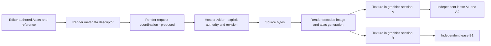

# VL01/VL02 — Visual Resource Loading ownership decision

2026-10-23. **API_DESIGN_ONLY**. No loader, cache, parser, lease or public symbol is
implemented here. Baseline: `33c9da5ac79cfce27043927fe5d7e08e3bd6d02c` on main,
the Phase 6 merge. [Task](tasks/visual-loading-v0.7.0.md),
[checkpoint report](../../harness/checkpoints/visual-loading-v0.7.0.md),
[complete public declaration inventory](public-api-baseline-v0.7.0.md).

## Decision and scope

Runtime Render is the single canonical owner of visual decode coordination,
normalized atlas/frame interpretation, GPU uploads, cache/lease lifetimes and
resource diagnostics. Editor owns authored Assets/catalog/references, document
state and preview host authorization. Client owns its authorized runtime source
provider and browser host. Neither host may introduce a competing texture manager.
No Engine/Server/L1/L2 change, sixth package or reverse dependency is required.

The task authorizes the design record and future allocation below, not production
APIs at this checkpoint. API names, provider method signatures, parser grammar,
eviction policies, image representation and texture defaults remain unselected
until evidence and a real consumer justify them. New APIs must be additive at the
Render root, with consumer compilation. Do not mutate prepareVisualResource into
an async loader or expose private Three/context objects. No source/import gap was
found requiring a Harness checker/config/rule change; none is made.

## Existing versus missing — actual source, not roadmap assumptions

| Surface / owner / current consumer | Existing baseline behavior | Missing / limit |
| --- | --- | --- |
| Render VisualResourceDescriptor; Editor adapter | identity projectId/resourceId, nullable image media hint, ordered role/project-relative locator list | No bytes, revision, authorization, image/atlas/frame or graphics handle |
| Render prepareVisualResource(input): VisualResourcePreparation; metadata manual consumers | Synchronous exact-record validation; detaches/freezes; image role required, duplicate role/path rejected; metadata-prepared / NOT_PERFORMED | No IO/decode/cache/GPU; media hint not sniffing; accepts multiple image roles, so page choice must become explicit rather than silently picking first |
| Editor describeResolvedVisualAsset(resolution, mediaType?): AssetVisualDescription | Only resolved kind image with image source maps; caller-supplied hint; unsupported otherwise | Does not pass authored metadata/dependencies/source IDs/subresource selection; no loading |
| Editor AssetReference + createAssetReference | Exact project/asset keys, expectedKind/null, nonblank opaque subresourceId/null | No frame syntax, parsing or atlas validation |
| Editor resolveAssetReference(catalog,input) | Explicit snapshot lookup; project/target/kind checks; any nonnull subresource returns SUBRESOURCE_NOT_SUPPORTED | No visual frame resolution; do not silently weaken this resolver to make atlas loading work |
| Editor createResourceLocator / asset-sources.ts | Only literal project-relative; strict lexical portability/traversal checks; ordered role/locator references | No root/URL derivation, file existence, filesystem/symlink authorization or IO |
| Render descriptor locator validation | Independently validates its neutral closed record and literal segments | Lexical accepted set differs from Editor (Editor additionally rejects reserved device/filename syntax); neither is a security capability or a provider |
| Render createRenderSession / createRenderSessionLifecycle | Binding-only target wrapper and lifecycle; id symbol | Not a graphics handle; never use as upload authorization |
| Render beginRenderFrameSession / createRenderFrameSession; Editor/Client manual hosts | Same canonical lazy acquisition, same-realm canvas, WebGL2/Three, private backend | No public resource attachment/upload method or texture ownership hooks; no acquisition cancellation |
| Render viewport/resize/suspension/invalidation | Explicit session-bound full-canvas state, CSS/ratio budgets/native extents, demand; synchronous renderFrame | Not a Resource/Scene/Document cache, no image draw path; submitted is not displayed |
| Render dispose + terminal native loss | Releases current backend/listeners, retains failure observations; cleanup uncertainty quarantines target | Current backend owns only empty scene/camera/renderer, not user texture leases; future resources must explicitly join this canonical cleanup before renderer disposal |
| Editor viewport-host / Client manual-frame-continuous | Root-only Render calls; independent host CSS/DPR/visibility/scheduling, late unwanted graphics result disposal | No source provider/decode/texture cache; separate manual browser entries, portable roots |

Implementation evidence: Render src/visual-resource.ts, frame-session.ts,
three-frame.ts, index.ts and emitted declarations; Editor src/asset-visual.ts,
asset-reference.ts, asset-catalog.ts, asset-sources.ts and root; Client root/manual
host; Editor manual guides. The complete export inventory records actual signatures
and declaration hashes. All five manifests/build boundaries remain unchanged.

Phase 6 RV19-COMPAT migration was accepted: graphics error codes/stages expanded;
unknown exceptions can remain unknown. Phase 6 merged with runtime verification
deferred; no new GPU evidence exists here. Preserve classifiers and truthful
unknown handling rather than broadening that accepted decision to future breaks.

## Ownership layers and proposed data flow

| Layer | Canonical owner | Lifetime/identity and allowed crossing |
| --- | --- | --- |
| Authored Asset | Editor | Stable project-local ID/catalog, ordered sources, opaque reference; never Render texture state or document dirty flag |
| Resource Descriptor | Render public; Editor adapts | Detached metadata value; host retains authored correlation; not source access authority |
| Authorized Source Bytes | Host provider grants access; Render coordinates consumption | Provider scope/permission and content generation; byte buffer ownership/release must be explicit, no default mutable sharing |
| Decoded image + normalized atlas/frame | Render | CPU resources immutable/borrowed only under explicit ownership; frame belongs to particular atlas generation/page, not gameplay entity |
| GPU texture | Render private backend | One canonical graphics context/session generation; opaque consumer use, no THREE/native handle in portable contract |
| Lease/consumer | Render manages lease accounting; host releases its own handle | Each acquisition has independent use/release; no asset ID implies ownership; host cannot destroy shared backing resource |



Everything after metadata preparation is **proposed, not implemented**. Conditional
CPU sharing is scoped to an explicitly held Render loading lifetime, not a global
asset singleton. Two hosts must explicitly share an authorized loading scope to
deduplicate CPU work; equal strings alone must never connect their caches. GPU
resources remain separate per graphics context, even if CPU data is shared.

## Cache identity principles — not a public key schema

Before cache reuse or in-flight deduplication, include all of:

1. Provider namespace AND authorization boundary/capability generation. Two users,
   roots, tenants or grants with equal paths/IDs must not share authorization by
   accident. Never place raw credentials or sensitive paths in public diagnostics.
2. Logical project/resource/source-role/page identity and exact request selection.
   Duplicate roles are legal source metadata; disambiguate with producer evidence.
3. Source revision/content generation, or an explicit host invalidation generation.
   Missing trustworthy revision requires a documented no-reuse/invalidation policy,
   never eternal path-keyed reuse. A source changing during a read must not publish
   inconsistent bytes under an older generation. Composite image/atlas revisions
   must describe a coherent pair/set, not unrelated files with equal names.
4. Content-affecting decode options and interpretation version (orientation,
   color conversion, premultiplication, resize policy where supported), and atlas
   parser/normalization version/options. Do not select defaults here.
5. GPU cache additionally includes canonical graphics session/context generation
   plus texture upload/sampling/color-space/flip/format/mipmap options that change
   the representation. No GPU entry may outlive terminal session identity.

Filename, path, Asset ID, URL and descriptor structural equality are each
insufficient alone. Invalidation changes admission for new requests; it must not
rewrite active immutable leases or free data still used by an older generation.
Deduplication creates independent leases, not alias release rights. A rejected
request must not be retained as a successful cache entry. Eviction/admission and
byte/pixel/GPU budgets need an explicit bounded policy before implementation;
reference counting alone is neither an eviction policy nor a leak-free proof.

## Lifetime, cancellation and cleanup ordering — proposed obligations

```text
request admitted under authorized generation
  -> bytes acquired -> decoded/atlas validated -> context-specific upload
  -> independent consumer lease -> release/terminal retirement
```

These stages are observations, not synonyms. Mark a resource usable only after
the actual required stage succeeds; do not fabricate a frame/display receipt.

Normal lease release: invalidate that handle once, decrement only its uses;
when the final relevant GPU use is retired, dispose its texture while its owned
renderer/context bookkeeping is still available. Then release retained CPU image
uses when no in-flight upload, CPU consumer or permitted cache retention needs
them; close an owned ImageBitmap only at that point. Release byte/provider handles
and any owned object URLs independently according to the provider contract.
Never close host-borrowed data or a shared CPU image on another lease's release.

Context disposal/loss: first mark the canonical graphics generation terminal and
deny new uploads/use; invalidate context-specific leases and stop adoption of late
work; drain/retire owned textures, then run existing scene/renderer/listener cleanup.
Attempt independent cleanup stages even if one fails, preserving original cause
and cleanup uncertainty. CPU data may survive only if a separate explicit loading
scope/lease still owns it. Native loss may make GL reclamation unobservable; report
uncertainty, not leak-free success. Do not recreate a disposed context automatically.

Late completion: validate request, source and context generations immediately
before publishing. A released/invalidated request cannot revive a consumer or
upload into a terminal session. Abort is an optimization, not the correctness
mechanism; non-cancellable decode/provider work must release unwanted results.
One consumer's cancellation must not cancel work another admitted consumer needs.
Exactly-once publication/retirement and idempotent release semantics require a
real implementation checkpoint; this document is not proof they already exist.

## Failure and compatibility matrix

The labels below are design categories, **not newly exported error codes**.

| Case | Detection/owner | Required evidence and retirement | Compatibility / phase boundary |
| --- | --- | --- | --- |
| Source unavailable or denied | Authorized host provider; Render request coordination | Actual rejected read or missing authorized source; no decode/upload success; release partial bytes | Locator alone cannot diagnose file missing; provider integration in Phase7, storage/asset server not invented |
| Decode unsupported/corrupt/over budget | Render decode stage + real platform decoder | Real format/capability/failure and input bounds, independent cleanup; no placeholder success | Explicit support scope; no PNG decoder in v0.7.0 or silent fallback |
| Malformed atlas/missing page/frame | Render parser/normalized frame resolution | Real producer sample/spec, invalid bounds/trim/rotation/page/frame evidence; atomic candidate rejection | TPSHEET_NOT_VERIFIED until sample; opaque authored subresource unchanged; no gameplay animation grammar |
| Stale or inconsistent revision | Provider revision/invalidation + Render admission | Revalidate coherent image/metadata generation; reject stale publish; old leases remain valid until retired | No path/ID-only cache; document dirty/save semantics unchanged |
| Late completion after release/invalidation | Render request/lease generation; host release intent | Real delayed operation observation, unwanted result independently retired, no revived lease | No mandatory cancellation mechanism or fake immediate abort; preserve current graphics late-result rule |
| Disposed/lost/unavailable context | Existing canonical Render session/backend | Real session terminal snapshot/failure, no upload or false usable handle; preserve cleanup uncertainty | Phase6 loss policy stays terminal; recovery explicit acquisition, no second renderer |
| Cleanup fails | Render resource owner + provider for its handles | Keep primary failure and independent cleanup failure/uncertainty; do not overwrite with success; quarantine where required | No new public diagnostic union now; future additive diagnostics must get consumer review |
| Metadata-prepared but not loaded | Existing prepareVisualResource | Existing NOT_PERFORMED stays exact | New separate loader entrypoint when justified; no sync-to-async break |
| Frame submitted but pixels absent | Render observation vs manual reviewer | Record real receipt separately from visible output | Scene Rendering/draw path is later scope; resource loading alone cannot claim Scene/Sprite/Animation/VFX works |

## Allocation across remaining checkpoints — provisional design, not implementation

VL01 architecture and VL02 baseline/public boundary are delivered by v0.7.0.
The task does not supply canonical names for VL03–VL20; this is the proposed
allocation, to be reconciled against each later supplied task before editing.
Future entrypoints below describe permitted surfaces, not promised symbol names.
R = Render owns resource semantics; E/C = Editor/Client host consumers only.

| Version / feature IDs | Scope and permitted entrypoint | Resource/cleanup obligation | Failure evidence / consumer impact |
| --- | --- | --- | --- |
| v0.7.1 VL03 | Host-authorized source access contract; separate R root request surface only if real consumer exists | Host grants/revokes scope, R coordinates bytes; define owned vs borrowed buffers | Provider/revision/containment evidence required; E/C adapters no filesystem/fetch inference |
| v0.7.2 VL04 | Bounded byte acquisition/admission through that provider | R owns admitted partial results, host owns permission; release failed reads | Real PNG bytes + limits/revision snapshot; compile E/C against new root |
| v0.7.3 VL05 | Explicit PNG decode support behind R request path | R owns decoded CPU result and closes only owned final-use data | Real decoder unsupported/corrupt cases, pixel budget; no fallback or animation |
| v0.7.4 VL06 | Decoded-image metadata/representation contract | R immutable dimensions/options/evidence; no implicit GPU allocation | Actual decode result vs source hint; E/C receive neutral observations |
| v0.7.5 VL07 | Atlas producer/format audit and bounded parser admission | R owns format interpretation; no parser without real sample/spec | TPSheet format/encoding/page linkage recorded or TPSHEET_NOT_VERIFIED; no fabricated grammar |
| v0.7.6 VL08/VL09 | Normalized atlas/frame metadata and visual subresource resolution through R root | R binds frame to atlas generation/page, validates rect/trim/rotation only when evidenced | Real sample frame/missing-frame evidence; E adapter preserves opaque authored reference, existing resolver unchanged |
| v0.7.7 VL10 | Context-specific texture upload through canonical R session/backend | R texture ownership joins existing session cleanup before renderer disposal | Real upload/native capability/terminal rejection; no exported Three/context handle |
| v0.7.8 VL11/VL12 | Explicit scoped CPU/GPU cache identity, dedup and bounded reuse | R loading scope, separate per-context GPU entries; revision/options/authorization key | Independent namespaces/options/revisions; E/C cannot gain permission through cache hit |
| v0.7.9 VL13/VL14 | Consumer lease acquire/release and safe shared use | R per-consumer handle, final-use retirement, old-generation isolation | Release A while B uses same CPU/source; different contexts never share native texture ownership |
| v0.7.10 VL15/VL16 | Late completion, terminal context and independent cleanup integration | R rejects stale publish; owned textures before backend; CPU kept only with explicit uses | Actual delayed provider/decode/dispose outcomes, primary+cleanup diagnostics; no resurrection |
| v0.7.11 VL17 | E authorized preview consumption through existing R root | E UI/provider/lease orchestration only; release before host unmount | Real authorized source and terminal close; no Editor decoder/cache, no document dirtiness from load |
| v0.7.12 VL18 | C authorized resource consumption through same R root | C runtime provider/consumer release; independent of Editor | Same real source contract without Editor runtime dependency; portable root preserved |
| v0.7.13 VL19 | Minimal working resource MVP via real root consumers | Exercise supported PNG/atlas/upload/share/release stages with true observations | Real PNG + metadata and browser; no fake TPSheet/display claim or Scene Renderer to satisfy MVP |
| v0.7.14 VL20 | Full phase inventory/compatibility/evidence closure | R primary + H audit, E/C review; all outstanding ownership/cleanup decisions visible | Exact-head CI, no tests, scope/consumer compile and manual evidence; Developer alone accepts/merges |

Missing sample/provider details are input gates for dependent implementations,
not blockers to this design-only checkpoint. No later task is supplied here;
this allocation does not authorize inventing v0.7.1 requirements or production
APIs to fill the table. Do not implement the next milestone in this commit.

## Input gaps and proof plan without a test framework

Audited tracked tree: `git ls-files '*.png' '*.PNG' '*.tpsheet' '*.TPSheet' '*atlas*'`
returns no sample files. No provided image/metadata payload accompanies this task.
There is no committed host source-provider or authorization/revision interface,
source-byte loader, decoder, atlas parser, texture cache or lease API in the three
projects (source searches and declarations inspected). Manual paths/metadata in
older docs are illustrative, not file/format evidence. Required next inputs:

- A real permitted PNG and associated metadata with provenance/producer version,
  expected dimensions and multi-page relationship where applicable.
- Real TPSheet sample + actual syntax/encoding/exporter/version, frame names,
  coordinate origin, trim/rotation/page behavior. Extension alone proves nothing.
- Host source-provider model: authority scope, allowed sources, byte ownership,
  coherent revisions/invalidation, read failure/abort semantics and resource
  limits. Desktop access requires actual root/realpath/containment enforcement;
  a browser provider must explicitly decide authorized URL/CORS/credential policy.
- Existing graphics APIs are available but have no texture attachment hook. A
  future root consumer and private cleanup integration must be designed together,
  without leaking renderer or reimplementing graphics sessions.

MVP proof, when real inputs/implementation exist: run the existing build/static
gates and compile a small root-only consumer; authorize a real provider; record
byte/revision/decode/atlas-frame observations separately. Acquire two canonical
graphics sessions; observe distinct GPU resources and independent consumer leases.
Release one lease while another is still active, then retire the last owner; record
late completion and terminal-context rejection from actual operations. Inspect
known source/decode/atlas failures and cleanup uncertainty. Browser display needs
actual visible output and a scoped rendering consumer authorized by its milestone;
the Phase6 empty-scene clear or upload alone does not display the PNG/atlas frame.
Do not build a Scene Renderer/animation player just to manufacture that evidence.
If no authorized draw consumer exists, record upload evidence only and leave
display pending. No test runner/assertions/Playwright/screenshot suite, synthetic
GPU fallback, measured performance claim or absolute leak-free claim.

## Upstream evidence, checked 2026-10-23

Installed lockfile/package source is authoritative for backend behavior:
Three0.186.1, @types/three0.186.0, TypeScript6.0.3. Read local
`node_modules/three/src/textures/Texture.js` (dispose dispatches event),
`renderers/webgl/WebGLTextures.js` (per-renderer source/property cache and native
delete on retirement), `renderers/WebGLRenderer.js` (context-bound texture
initialization, disposal and loss/restore handlers). Platform three-frame.ts owns
the renderer and removes its restore handlers on terminal loss; no user textures
exist in its empty scene today. Three initTexture/needsUpdate is an upload path,
not an application-level lease, authorization or display receipt.

Three requires texture disposal separately from materials and application-owned
ImageBitmap closing; our proposed split lifetimes follow that distinction.
[Official disposal guide](https://threejs.org/manual/pages/how-to-dispose-of-objects.html),
[r186 documentation](https://github.com/mrdoob/three.js/blob/r186/manual/pages/how-to-dispose-of-objects.html).
Context7 r186 references informed lookup; local locked0.186.1 source was checked
instead of assuming online latest and patch source are identical.

Addressables illustrates matching acquisition/release ownership; zero reference
count does not necessarily mean immediate memory reclamation. Adopt only that
ownership principle, not Unity bundles or its runtime.
[Official Addressables3.1 memory guide](https://docs.unity3d.com/Packages/com.unity.addressables@3.1/manual/memory-assets.html).
The task's unity.cn URL timed out; official unity3d counterpart was read.

Godot distinguishes cache reuse from replacement (including dependency policies).
Use that as evidence to make our policy explicit, not to copy ResourceLoader's
singleton/filesystem/import model.
[Official Godot4.5 ResourceLoader](https://docs.godotengine.org/en/4.5/classes/class_resourceloader.html).
Neither engine introduces a dependency or public contract in this workspace.
